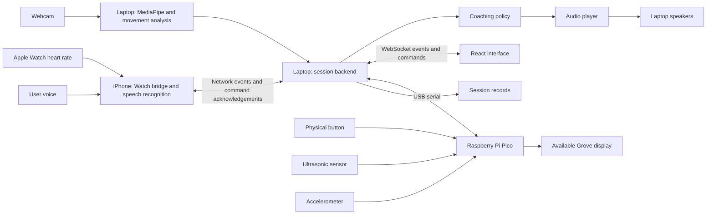

# Gym&AI — 24-Hour Hackathon Team Brief

**Team:** Chase, Bryan, Tyler, Taher  
**Purpose:** Give everyone a shared definition of the product, their responsibilities, the interfaces between their work, and the minimum demonstration we will deliver.  
**Confirmed exercise scope:** Three required analyzers: squat, biceps curl, and deadlift. Recorded demonstrations cover all three; biceps curls are the live judges demo. Pushups are optional. Bench press is deferred.  
**Confirmed roles:** Chase — movement analysis; Bryan — UI; Tyler — backend, audio, and integration; Taher — hardware and enclosure.  
**Confirmed available hardware:** Raspberry Pi Pico/RP2040, webcam, Grove button, Grove 3-axis digital accelerometer, ultrasonic distance sensor, and a Grove LED/7-segment display. The Pico is the board; RP2040 is its microcontroller chip. Exact sensor/display variants remain to be identified.  
**Proposed software:** React + TypeScript and Python + FastAPI, with MediaPipe for pose estimation.  
**Confirmed coaching additions:** Apple Watch heart-rate input, voice feedback through its paired iPhone, encouragement, rest suggestions, and optional water-break reminders. A paired iPhone and Mac with Xcode are available. Native watchOS/iOS integration is now part of the prototype plan.  
**Outstanding setup details:** Exact sensor/display model numbers, laptop configuration, and the dumbbell or suitable curl equipment for the live judges demo. Recording arrangements for squats/deadlifts are handled before rehearsal. Use laptop speakers for audio because a separate speaker was not included in the confirmed inventory.

## 1. Product and demonstration

Gym&AI is a home workout companion that observes movement through a camera, considers Apple Watch heart-rate data and the user's spoken feedback, and responds like a supportive personal trainer. It corrects supported movement issues, celebrates progress, checks in when movement becomes difficult, and offers rests or water-break reminders. Its defining interaction is automatic intervention: once a session begins, the user should not need to keep checking a screen or asking for every cue.

The full product would combine goal onboarding, workout planning, exercise recognition, repetition tracking, movement feedback, workout history, and adaptive plans. Our hackathon prototype will demonstrate a narrow but complete version of that experience.

**The main demo:** A user selects a goal, starts a short workout, positions themselves in view, performs a set, receives a specific spoken cue, changes their movement, and sees the system acknowledge that improvement. The screen and physical device respond to the same workout events.

### Confirmed recorded and live demonstration plan

| Demonstration | Exercise | Input and goal |
|---|---|---|
| Recorded | Squat | Capture workout footage and show actual repetition analysis, a supported cue, and the response to improved movement |
| Recorded | Biceps curl | Show the same curl analyzer used for the live judges demo, with annotated footage for repeatable verification |
| Recorded | Deadlift | Show exercise-specific phases and a supported correction using footage captured with an appropriate setup |
| Live for judges | Biceps curl | Webcam observes a teammate in the venue; rep count, spoken feedback, and Pico display update from actual movement |
| Optional live alternative | Pushup | Add only after implementing and testing a separate pushup configuration; not a required fallback |
| Deferred | Bench press | Future exercise support; excluded from the hackathon's required implementation and demonstrations |

**Recorded-demo deliverables:** Prepare short squat, curl, and deadlift exercise clips plus a screen recording/demo video of the working app. The team can either analyze the saved exercise clips inside the app during the presentation or show the captured app demonstration. Label saved-video analysis as recorded input. Keep a clearly labeled final demo video available as a backup. Counts and feedback shown in the recording must come from the actual analyzer, not a scripted UI sequence.

**Live-demo deliverable:** Rehearse webcam curls on the final laptop in a comparable judging space. Prepare the camera angle, appropriate curl equipment, cached audio, and a clear start action. Demonstrate rep counting and a supported movement change that alters the feedback. End the set and show a real recap. A working recorded curl clip does not replace testing this live path.

Extend the live curl demonstration with actual Watch heart-rate updates and a spoken phone command such as "This is hard" or "I need a break." The coach should acknowledge the report, offer or enter a rest as appropriate, clear queued encouragement, and resume only after the user requests it and tracking reacquires. Show a hydration reminder between sets if enabled. Do not deliberately push someone into distress to demonstrate a rest branch.

**Suggested presentation sequence:** Briefly explain the product, show the recorded squat/curl/deadlift examples, demonstrate live curls with the physical device, and show the recap. Explain that vision runs on the laptop and the Pico handles controls/display. Keep each recorded example short enough that the live interaction remains central.

**Input-mode implementation:** Both webcam frames and saved-video frames enter the same analyzer. For clip analysis, use the file's frame timestamps for movement timing and pace playback so audio and UI can follow the displayed video. Pause, replay, seek, and source changes reset or restore analyzer/session state deliberately; stale counts and cues must not carry into a new run. Replaying a completed demo video requires no inference and must be distinguished from analyzing a file in the app.

Ultrasonic and enclosure-motion readings describe the real room/device. They must not invalidate a person's pose inside a prerecorded clip. Apply those positioning enhancements to live capture only; the Pico can mirror rep counts in either mode.

The proposed visual identity combines Wii Fit's friendly encouragement with a simple, polished interface and an Octobuddy-style companion. The companion makes system state understandable rather than distracting from the workout.

### Definition of a successful submission

- The webcam captures the exercising user.
- The app visibly distinguishes reliable tracking from an insufficient camera view.
- Each of the three required exercises has a usable repetition counter in its documented camera setup.
- Each exercise has at least one reviewed, observable movement criterion that produces a meaningful correction.
- The correction plays through the speaker during the session.
- Subsequent movement can trigger an improvement acknowledgement.
- The UI shows the exercise, reps, tracking state, and current cue.
- The Pico button and available display react to real session events.
- A recap summarizes the actual completed set.
- The team can explain which processing runs on the laptop and which runs on the Pico.
- The paired Watch/iPhone supplies timestamped heart-rate updates to the backend and exposes missing/stale data honestly.
- A spoken phone request for a break or pause changes the session and receives an acknowledgement.
- Encouragement, form correction, and rest suggestions are selected by a shared coaching policy rather than independent competing audio loops.

## 2. Scope and priorities

### Required for the demo

1. A short onboarding flow: goal, experience, equipment, and session length.
2. A predefined workout selected from those answers.
3. Camera capture and MediaPipe pose estimation on a laptop.
4. Exercise-specific repetition phases and movement checks for squat, biceps curl, and deadlift, with live curl support.
5. Tracking confidence and camera-position guidance.
6. Brief spoken cues generated beforehand with ElevenLabs.
7. A live workout interface and animated companion states.
8. A physical start/pause button and the available display controlled by the Pico.
9. A session recap using real session data.
10. A minimal watchOS/iOS bridge for heart-rate input and phone voice commands.
11. A coaching policy that combines movement observations, user-reported effort, available heart-rate context, and workout state.
12. Supportive encouragement, explicit break requests, a rest state, and optional between-set water reminders.

### Stretch goals, in priority order

1. Pushup analysis as an optional second live-demo exercise, only after all three required analyzers pass.
2. Automatic recognition among supported exercises and idle/unknown movement.
3. Ultrasonic positioning hints and accelerometer-based camera-movement detection.
4. Additional reviewed movement checks beyond the first criterion per exercise.
5. Saved history and a simple suggested adjustment for the next workout.
6. Broader conversational voice interaction beyond the required small phone command vocabulary.

Apple Watch/HealthKit live input and phone voice commands are now in the prototype plan. AirPods-specific polish, Meta glasses, custom pose-model training, long-term HealthKit history sync, and fully standalone hardware belong to the later roadmap. The hackathon demo should not present unfinished integrations as completed.

**Exercise recognition in the first version:** The workout plan tells the analyzer what exercise to expect. The analyzer still observes the movement automatically. If we add automatic recognition, it must include an unknown state rather than force every movement into an exercise label.

Reuse a shared phase counter, tracking checks, tempo measurements, feedback scheduler, and UI. Keep the first feedback criterion narrow for each exercise. Build and validate live curls first, then apply the same pipeline to recorded squat and deadlift footage. Pushups require a separate configuration and tests; bench press is outside the required hackathon scope. If a criterion or camera view fails testing, document the limitation rather than claiming support from an unverified skeleton overlay.

### Exercise definitions and first implementation targets

These camera views and features are starting hypotheses to validate on real clips, not guaranteed tracking configurations or universal lifting instructions. Calibrated targets must be exercise-specific and reviewed before becoming spoken corrections.

| Exercise ID | Initial camera setup to test | Rep-phase outline | Features to investigate | Initial feedback scope and limit |
|---|---|---|---|---|
| `squat` | Side view with shoulders, hips, knees, and ankles visible | Standing → lowering → bottom → rising → standing | Hip/knee movement and phase duration | Reviewed tempo or range relative to a calibrated target; frontal alignment checks require another suitable view |
| `deadlift` | Side view showing shoulders, hips, knees, and ankles | Bottom position → lifting → standing → lowering → bottom position | Hip/knee change and shoulder/hip movement | Reviewed tempo or visible range; sparse body landmarks do not establish spinal curvature or actual bar path |
| `curl` | Side or slight oblique view showing shoulder, elbow, and wrist | Lower position → curling → top → lowering → lower position | Elbow angle and upper-arm movement relative to torso | Reviewed tempo or range; suppress evaluation when equipment/body occludes the necessary joints |
| `pushup` — optional | Side view showing shoulder, elbow, wrist, hip, and ankle; validate floor-level visibility | Upper position → lowering → bottom → pressing → upper position | Elbow movement, phase duration, and coarse body-segment alignment | Separate reviewed criteria and tests; no assumption that bench/curl logic transfers unchanged |

Use one exercise ID throughout the analyzer, backend, UI, saved records, audio mapping, and device messages. Required IDs are `squat`, `curl`, and `deadlift`; expose optional `pushup` only after implementation and validation. Define the exercise variation used in the demo and calibrate to that variation; do not combine materially different setups under one unexplained target.

Each exercise must expose its own required landmarks, initialization phase, phase thresholds, validity rules, supported issue codes, and camera instructions. A change of exercise or camera position resets tracking/phase calibration. Choose an explicit policy for incomplete reps and partial cycles; do not count them accidentally as complete.

**Demonstration equipment:** Squat and deadlift footage can be captured where appropriate equipment is available before the presentation. The live judges demo requires the webcam, a usable camera position, and suitable curl equipment. The team is not relying on a bench or barbell at the judging table. Identify recorded input clearly on screen; validate live curls separately in the venue.

### Adaptive coaching: how Gym&AI acts like a trainer

The vision model observes movement. A separate backend coaching policy combines those observations with Watch samples, voice input, the workout plan, and recent coaching history. Start with explicit, testable rules and approved cue templates. A language model is not required for the demo. If richer phrasing is added later, it must not override the policy's pause/rest decisions or invent sensor readings.

| Input | Information available | Interpretation limit |
|---|---|---|
| Form observations | Supported issue codes, joint visibility, rep phase, and trend across reps | Only evaluate criteria that the current view supports |
| Movement timing | Rep duration, interrupted cycles, range changes, and pauses | These can indicate possible difficulty, but also intentional tempo or tracking failure |
| Heart rate | BPM, sample time, source, freshness, and recent trend | Heart rate alone does not determine strength-training fatigue, dehydration, or permission to continue |
| Voice feedback | Easy/moderate/hard, requests for a break/water, pause/resume/stop | Explicit stop/rest requests take priority over encouragement |
| Workout context | Exercise, target, completed reps, rest state, and user preferences | Do not announce remaining reps if no target is defined |

Treat slower repetitions, reduced visible range, and repeated interruptions as **possible difficulty**, not a diagnosed fatigue state. Ask a short question such as "How is this feeling?" before drawing a stronger conclusion. Never interpret missing landmarks as proof that the user is struggling. User-reported effort is meaningful context; CDC describes perceived exertion as one way to assess relative activity intensity, although its intensity guidance concerns aerobic activity rather than validating this lifting algorithm. [CDC reference](https://www.cdc.gov/physical-activity-basics/measuring/).

| Situation | Proposed coach action | Example cue |
|---|---|---|
| Consistent movement; no active correction or rest request | Occasional specific encouragement | "Your movement is staying consistent. Nice work." |
| Supported form/tempo issue persists with reliable tracking | One actionable correction | "Slow the lowering phase to your target pace." |
| Subsequent reps resolve a supported issue | Acknowledge the actual change | "That pace is more consistent now." |
| Movement changes suggest difficulty, but user state is unknown | Ask about effort and offer options | "How is this feeling? You can take a break." |
| User says "This is hard" | Acknowledge difficulty, offer rest, avoid pressure to finish | "Understood. Would you like a break?" |
| User says "I need a break" or "Pause" | Enter rest/pause; stop counting and clear active coaching cues | "Paused. Take the time you need." |
| User says "Stop" | End the set/session according to the defined command; suppress continuation prompts | "Workout stopped." |
| Fresh HR trend reaches a reviewed personal advisory condition | Ask how the user feels and suggest rest; avoid medical conclusions | "How are you feeling? Let's consider a rest." |
| Heart-rate data is missing or stale | Mark it unavailable; continue form/effort coaching without HR claims | "Heart-rate updates are unavailable." |
| Between sets, a reminder is due and enabled | Optional water-break prompt | "This is a good moment for a water break if you need one." |
| Rest timer ends | Ask readiness; do not automatically restart | "Ready to continue, or would you like more time?" |

**Heart-rate policy:** Do not use a universal BPM cutoff or a simple age-predicted maximum as a medical safety boundary. Configure any advisory band with appropriate review and personal context; otherwise show the trend and ask about effort rather than implementing a high-HR decision rule. The AHA notes that age-based ranges are averages and medications can change heart-rate responses. A falling or low BPM reading is not a clearance to keep exercising. [AHA guidance](https://www.heart.org/en/healthy-living/exercise-and-physical-activity/fitness-basics/target-heart-rates).

**Water-break policy:** These are optional reminders scheduled at natural pauses, not a dehydration detector. The camera and Watch do not establish hydration status. Do not prescribe a fixed water quantity from BPM. Fluid needs vary with exercise, environment, and individual circumstances. [AHA hydration reference](https://www.heart.org/en/healthy-living/exercise-and-physical-activity/fitness-basics/staying-hydrated-staying-healthy).

**Priority and timing:** Explicit stop/pause/rest requests override other cues. Positioning uncertainty pauses assessment. Persistent supported movement issues take priority over general encouragement. Water reminders wait for a pause between sets. Use one audio scheduler with cooldowns, short cues, and cancellation of stale messages. User reports of pain, dizziness, or feeling unwell route to stopping the workout, not motivational pressure. Resume requires a user command and successful tracking reacquisition; the system is not declaring medical readiness.

**Coaching state:** Keep session state separate from coach state. Session states remain ready/active/paused/complete. Coach states can be observing/correcting/checking_in/encouraging/resting/complete. Beginning a rest pauses repetition counting; extend-rest and resume commands update the same backend session path. The rest timer is a configurable plan value, not a promise that a given duration establishes recovery. Let users reduce chatter and disable hydration reminders.

**Acceptance:** Test consistent movement → encouragement; known issue → correction; confirmed improvement → acknowledgement; reported hard effort → rest offer; break request → pause; resume → reacquisition; stale HR → unavailable; and water reminder → between-set cue. Log the observation and reason that selected each action. No encouragement should conflict with an active stop/rest request.

## 3. Hardware and architecture

The user's confirmed inventory below is the source of truth for this build. Items elsewhere in MLH's general catalog are not assumed available. Confirm sensor and display variants before choosing drivers or wiring.

| Component | Prototype responsibility |
|---|---|
| Team laptop | Camera capture, pose inference, movement logic, session management, audio playback, and UI hosting |
| Webcam | Video input; connect directly to the laptop; exact model unconfirmed |
| Laptop's built-in speakers | Spoken feedback; no separate speaker is confirmed |
| Apple Watch | Actual heart-rate samples during a native workout session |
| Paired iPhone | Receives Watch data, captures voice feedback, and forwards normalized inputs to the laptop |
| Mac with Xcode | Build, sign, and install the minimal watchOS/iOS companion apps; availability confirmed |
| Raspberry Pi Pico/RP2040 | Read button and sensors, exchange USB messages, and update the available display |
| Grove button | Start/pause command |
| Grove 3-axis digital accelerometer | Proposed camera/enclosure movement detection if mounted there; model-dependent driver |
| Ultrasonic distance sensor | Proposed coarse positioning hint after testing its real readings and usable range |
| Grove LED/7-segment display | Show reps if numeric; otherwise show a defined status/progress pattern |
| USB data cable, wires, appropriate adapters and mounting supplies | Required support items; Taher verifies availability rather than assuming them |



The Pico does not run MediaPipe or process the webcam stream. A laptop supplies its power and exchanges control messages over USB. The physical enclosure may contain the webcam, Pico, button, sensors, and display, with separate connections to the laptop. This is a laptop-assisted prototype.

**Display identification:** A seven-segment numeric display is different from an LED bar. Taher identifies the exact part and digit count. A numeric display can mirror reps; an LED bar can show progress or system state without implying a validated form score. A single digit must not silently wrap a count above nine. The React interface always shows the full count. A TM1637 four-digit module, if that is the actual part, uses CLK/DIO rather than I2C; other displays require their own driver. [Seeed display example](https://wiki.seeedstudio.com/Grove-4-Digit_Display/).

**Ultrasonic sensor:** Mount it facing the workout area and test whether it reliably detects the person in that setup. Treat valid readings as a coarse distance hint, not body identification, pose tracking, or a form measurement. Clothing, equipment, the nearest surface, and timeouts can affect which distance is reported. Camera visibility remains the main readiness check. Keep this enhancement independent of the core rep counter. [Grove Ranger example; exact variant to confirm](https://wiki.seeedstudio.com/Grove-Ultrasonic_Ranger/).

**Accelerometer:** Mount it to the camera enclosure to detect that the device has been bumped or tilted, then request camera repositioning/recalibration. This measures movement of the object carrying the sensor. In that location it does not measure the athlete or barbell. A wearable/equipment-mounted mode would require a separate mounting, cabling, and interpretation design and is deferred. The ADXL345 module is one possible variant, not an assumption about the borrowed sensor. [Seeed accelerometer example](https://wiki.seeedstudio.com/Grove-3-Axis_Digital_Accelerometer-16g/).

If a Pi 4/5 unexpectedly becomes available, moving processing onto it is optional work after the laptop demo is reliable. Benchmark the real pipeline before promising standalone operation.

## 4. Software stack

| Layer | Technology | Owner |
|---|---|---|
| Camera/frames | OpenCV | Chase |
| Body landmarks | MediaPipe Pose Landmarker; Full initially, Lite if needed | Chase |
| Movement features | NumPy and exercise-specific Python logic | Chase |
| Session API | Python + FastAPI | Tyler |
| Coaching decisions | Python rules/state machine with approved cues | Tyler; Chase defines movement observations |
| Watch heart rate | Swift/SwiftUI + HealthKit workout session and live builder | Tyler; Taher helps device setup/testing |
| Phone bridge/voice | Swift/SwiftUI + Apple Speech/AVAudioEngine + networking | Tyler; Bryan helps minimal phone UI |
| Live UI events | WebSockets | Tyler and Bryan |
| UI | React + TypeScript + Vite | Bryan |
| Styling/animation | CSS or Tailwind; small state-based animations | Bryan |
| Voice assets | ElevenLabs-generated cues stored locally | Tyler |
| Playback | Laptop's built-in audio output | Tyler |
| Optional persistence | SQLite; live session state can stay in memory | Tyler |
| Laptop/device bridge | USB serial; Python serial library; button/display commands and optional sensor telemetry | Tyler and Taher |
| Pico firmware | A supported toolkit Taher can bring up quickly | Taher |

Use one integration laptop for the final demo. Other teammates can develop independently using recorded clips and simulated events. Keep dependency versions agreed and recorded once the environment works. Download the pose model and prepare audio assets before rehearsing.

### Minimal Watch and phone implementation

1. Use a small watchOS app to start an explicit workout session and receive heart-rate updates through HealthKit's live workout builder. Request only the needed HealthKit access, show that a workout is running, and handle session end/failure. [Apple workout sessions](https://developer.apple.com/documentation/healthkit/running-workout-sessions).
2. Mirror the workout to its paired iPhone and send heart-rate messages through the supported workout-session communication path. Verify installed OS compatibility before choosing the sample/API version. [Apple multi-device sample guidance](https://developer.apple.com/videos/play/wwdc2023/10023/).
3. The iPhone forwards BPM, original sample timestamp, participant/session ID, and source to Tyler's laptop backend over the local network. Preserve sample time; network receipt time does not make an old sample fresh. Configure local-network access and test the actual event Wi-Fi or another allowed network arrangement early.
4. Capture short spoken feedback through the phone microphone using Apple's Speech framework. Request microphone/speech permissions and normalize a small vocabulary: "easy," "moderate," "hard," "I need a break," "water break," "pause," "resume," and "stop." [Apple live-speech guide](https://developer.apple.com/documentation/speech/recognizing-speech-in-live-audio).
5. Display what was recognized and whether the backend acknowledged the command. Use a simple tap-to-talk path initially while testing hands-free capture; the workout still supplies automatic coaching. Handle unavailable recognition/uncertain speech without inventing an effort report. UI/Pico pause controls remain usable.
6. Keep coaching playback on the laptop in the first version. Test the phone microphone's response to those speakers, suppress the coach's own speech as commands, and avoid competing recognition tasks. Broader always-listening conversation and phone audio output are optional polish.

Owning a Watch is not equivalent to having a working live data stream. Prove one real Watch sample and one real phone voice command reaching the backend early, then build the coaching rules. If integration is incomplete, a labeled demo input can exercise the policy for rehearsal, but cannot be presented as actual live Watch/voice functionality.

Recorded exercise footage must not be combined with the current presenter's Watch readings as if they belong to the filmed athlete. Use synchronized recorded HR from the same person/session when available, explicitly labeled demo telemetry for demonstrating the policy, or no HR for those clips. Real current Watch readings belong to the live curl session.

## 5. Chase — movement analysis

### Ownership

Chase owns the transformation from camera frames into measurable workout observations. The backend should not need to know MediaPipe landmark indices or duplicate exercise calculations.

### Build sequence

1. Capture frames and confirm an appropriate camera angle for the selected exercise.
2. Display a skeleton overlay to debug landmark tracking.
3. Check visibility of the joints needed for the current exercise.
4. Smooth landmark or feature values to reduce jitter.
5. Calculate relevant joint angles, normalized distances, and movement timing.
6. Implement repetition phases with different entry/exit thresholds and minimum durations.
7. Add one reviewed movement criterion, then expand only after testing.
8. Emit structured observations for Tyler's session backend.
9. Expose rep duration and range trends across comparable reps in the current set. Mark possible difficulty with its evidence and tracking quality; never label a slowdown as confirmed fatigue.

Implement a reusable analyzer with three required exercise configurations rather than three unrelated video scripts. It should accept the selected exercise ID and input source, and return the same observation shape for each exercise. Develop using labeled clips while Tyler tests the integration independently.

For a squat, the initial phase sequence is standing → descending → bottom → ascending → standing. Only a completed valid cycle increments the rep counter. Pause counting when the necessary joints are obscured or tracking is unreliable; reacquire a known phase before resuming.

Tempo and range relative to a reviewed, calibrated target are candidate demo criteria. Select criteria that the chosen camera view can actually observe. Avoid a universal angle threshold or a claim that one camera establishes every aspect of correct form.

Compare tempo only within the same exercise, load context, and intended movement style. Slow controlled reps can be intentional. A sustained change from earlier comparable reps can prompt an effort check-in, but the user's answer determines whether they want encouragement or a break. Reset the trend baseline when the exercise, source, or set changes.

MediaPipe supplies landmarks, including estimated 3D coordinates. It does not supply exercise labels, repetition counts, or form judgements. We implement those layers. Estimated depth must not be treated as precise measured biomechanics.

### Deliverables and acceptance

- A callable analyzer interface that Tyler can run without a UI.
- Live and recorded-video inputs using the same analysis code.
- Exercise configuration, required landmarks, phase definitions, and supported checks.
- Three required configurations: `squat`, `curl`, and `deadlift`; optional `pushup` after the core demo is reliable.
- Live webcam curls validated in the actual judging setup, plus recorded demonstrations of all three required exercises.
- Annotated source clips and frame timestamps for recorded squat, curl, and deadlift validation.
- Repeatable counting for each exercise on annotated clips, with more than one person where footage is available.
- A tracking-lost result when the required joints are hidden.
- Evidence that the correction stops or changes when the observed issue improves.
- Structured timing/range observations that the coach can explain, and no difficulty inference when tracking is unreliable.

Tyler helps test clips and results; Chase remains the owner of analysis decisions.

## 6. Bryan — interface and experience

### Ownership

Bryan owns onboarding, workout presentation, companion animations, and the recap. The UI consumes backend state; it does not independently count repetitions or decide when audio should play.

### Screens

| Screen | Required behavior |
|---|---|
| Onboarding | Collect a few answers and select a suitable predefined demo workout |
| Positioning | Show camera preview/overlay if available and a clear tracking-ready indicator |
| Workout | Exercise selector, target, completed reps, session/coach state, current feedback, Watch BPM with source and freshness, last acknowledged effort report, and start/pause/end controls |
| Rest | Reason for the pause, optional elapsed/countdown timer, encouragement, optional water reminder, and explicit resume/end controls |
| Recap | Actual completed reps, supported observations, and one useful next-session focus |

The initial goal choices can be strength, muscle gain, and consistency. These select reviewed templates; they do not imply that the prototype has generated a personalized training prescription.

Companion states: ready, positioning, tracking, correction, improved, checking in, encouraging, resting, and complete. Use text alongside colors so states remain understandable. Show a connection-lost message when backend updates stop. Do not keep displaying stale tracking or heart rate as live.

Help Tyler keep the native phone screen minimal: connection status, recognized command, backend acknowledgement, and voice/control fallback buttons. A recognized transcript is not yet a completed action. Show unavailable/stale Watch status distinctly; BPM colors must not imply medical clearance. Include optional quiet-coach and water-reminder preferences. A rest timer reaching zero prompts readiness rather than automatically restarting the set.

Each exercise has a camera-position instruction and its own supported-feedback description. Display whether input is live or recorded. Show optional sensor readings only when they add useful positioning guidance; diagnostic values belong in a developer view. Changing exercise sends a backend command and waits for the new state before showing active tracking.

Provide explicit live-webcam and recorded-clip modes. Recorded mode needs playback controls that stay synchronized with analysis; a final demo-video playback is a separate presentation asset. Keep unsupported/deferred exercises out of the active workout selector. Live mode defaults to curl for the judging demonstration.

### Deliverables and acceptance

- Screens usable with a small simulated-event fixture while ML is in progress.
- A documented WebSocket consumer and command interface coordinated with Tyler.
- No mandatory screen interaction during a set after the session begins.
- A graceful state for missing camera visibility or a disconnected backend.
- A recap derived from real completed-session records.
- Consistent exercise selection, positioning instructions, and feedback presentation for all three required exercise IDs.
- No numerical form score unless its definition and calculation are explicitly implemented and validated.
- Actual Watch samples, unavailable/stale states, effort acknowledgements, and rest transitions are visible and correctly labeled.

## 7. Tyler — backend, audio, and integration

### Ownership

Tyler owns the shared session state, coaching policy, audio scheduler, Watch/iPhone bridge, and phone voice commands. Start/pause commands from the screen, phone, and Pico use the same backend path. Bryan helps keep the phone UI small; Taher helps deploy and test on the paired devices. Native app development is a substantial additional task: Xcode availability is confirmed, but the team must prove device deployment and data flow early.

### Build sequence

1. Define and publish event examples before the other components are ready.
2. Bring up FastAPI and a WebSocket connection to Bryan's interface.
3. Deploy the smallest Watch/iPhone app and prove one actual heart-rate sample and one phone voice command reaching the server.
4. Run clearly labeled simulated workout events through UI, audio, and device paths while real inputs are integrated.
5. Implement the coaching policy and normalized effort/control intents; use approved templates for correction, encouragement, rest, and water reminders.
6. Integrate Chase's analyzer in a worker so inference does not block API responsiveness.
7. Add prioritized audio scheduling, cached cue playback, and immediate cancellation on pause/stop.
8. Connect the Pico over USB serial.
9. Build actual set/session records and the recap response; add persistence only if time remains.

Add exercise changes and input-source metadata to the session model. Exercise changes reset the current repetition phase through Chase's analyzer, clear queued cues, and start a new set record. Keep separate counts and issue occurrences for each exercise. Optional Pico telemetry should not directly increment repetitions.

Provide a source adapter for webcam and saved files. A recorded-file session uses clip time for movement durations and coordinates pause/replay with analysis, queued audio, the UI, and the device count. Do not rush a file through inference and play all its feedback afterward. Ignore live-room positioning telemetry for recorded-file analysis. Support switching back to the webcam without restarting the whole app.

Suggested API surface: `POST /api/sessions`, `POST /api/sessions/{id}/commands`, `GET /api/sessions/{id}`, and `WS /ws/workout`. Onboarding/workout selection can initially use local templates. The backend is the authority for session state and committed repetition counts.

Add `POST /api/sessions/{id}/heart-rate` for normalized phone-forwarded samples and `POST /api/sessions/{id}/feedback` for effort reports. Control intents such as pause/stop/resume go through the common command endpoint. Use explicit session/participant pairing and a session-scoped connection token so another phone cannot accidentally control the judging session. Reject mismatched, duplicate, malformed, or out-of-order inputs as appropriate; a delayed resume command must not override a newer stop.

Track sample time and receipt time separately, agree on a configurable freshness window after observing actual Watch cadence, and mark stale samples unavailable for decisions. Handle clock skew rather than accepting a future timestamp indefinitely. Keep live physiology out of unrelated recorded clips. Log the input evidence, rule, and action so the team can explain why the coach spoke.

### Audio behavior

- Prepare a small set of reviewed, short ElevenLabs cues before the demo.
- Map each supported issue code to a defined cue.
- Use exercise-specific cue mappings for squat, biceps curl, and deadlift; tracking/positioning cues are separate from movement corrections.
- Speak one cue at a time; stop/pause/rest acknowledgements take priority, followed by tracking guidance and the most useful current correction. General encouragement waits for an appropriate moment.
- Apply a configurable repeat cooldown; start around five seconds and tune during testing.
- Cancel stale queued cues when the issue resolves, the session pauses, or the set ends.
- Play improvement feedback after subsequent movement confirms a change.
- Keep corrections working from local assets when the internet is unavailable.
- Store service credentials on the backend, not in frontend code.
- Avoid coaching chatter on every rep; praise observable progress and honor quiet-coach settings.
- Pause speech recognition while the system speaks if echo causes false commands; show listening state. Test the actual phone/speaker placement.
- Deliver optional water reminders between sets or during rest. Do not interrupt a difficult rep with an unrelated reminder.

### Deliverables and acceptance

- A session can be started, paused, resumed, and ended from the UI.
- The physical button follows the same state transitions.
- A real rep event updates UI and optional hardware once, without duplicate counting.
- All three required exercise IDs route through the same session/event path with correctly matched cues and per-exercise records.
- Feedback audio is understandable and does not pile up behind the workout.
- The camera/inference loop stays responsive while sound plays.
- The final demo can restart without manual editing of source code.
- Timestamped samples from the actual Watch reach the backend; permission failure, stale data, and disconnects produce honest status.
- Phone commands update the authoritative session once, with visible acknowledgement; stop/pause take effect without waiting for a generated voice response.
- Supported movement observations, effort reports, and available HR context produce the documented coaching transitions without contradictory queued cues.

## 8. Taher — hardware and enclosure

### Ownership

Taher owns the physical control circuit, Pico firmware, display integration, sensor integration, camera mounting, and device presentation. AutoCAD experience is useful for planning component placement and clearances; printing or fabrication depends on available tools.

Taher also helps Tyler verify the paired Watch/iPhone, development deployment, HealthKit/microphone/speech permissions, network connectivity, charging, and microphone placement. The Pico sensors do not measure heart rate or hydration. Keep the hardware path independent enough that a sensor fault does not break phone commands or coaching.

### Build sequence

1. Identify the Pico, exact accelerometer, ultrasonic sensor, display type/digit count, headers, data cable, and adapters.
2. Establish USB communication with Tyler before building an elaborate enclosure.
3. Make a button press produce a serial event with debouncing.
4. Receive state/count commands and update the available display.
5. Verify each module's power, signal voltage, and wiring against its documentation.
6. Mount the camera securely at a useful adjustable angle.
7. Arrange the components in a simple housing with accessible cables and controls.
8. Bring up ultrasonic readings and accelerometer readings independently after button/display communication is stable; add the positioning/movement enhancements only after testing them.

For a numeric display, mirror the backend's committed rep count. Use documented blink/blank patterns for paused or positioning states only if supported by the actual hardware. If the part is an LED bar, define state/progress patterns instead. Do not assume an LCD, separate LED kit, or additional speaker is available. Keep full messages and complete rep counts on the React interface.

Send optional range readings with units and a validity flag; a timeout is not zero distance. Send accelerometer readings with explicit units and sample timing if the motion-detection enhancement is enabled. Calibration and camera-movement thresholds are determined from tests on the actual mounted device. Verify 3.3V GPIO compatibility before connecting any module; similar-looking Grove modules may use different drivers or power arrangements. Exact pin assignments wait until part identification.

Choose a stable mounting method available at the event. A polished CAD concept plus a working simple housing is sufficient if fabrication time is limited.

Prioritize a mount that gives a clear live curl view in the judging space. Rehearse that position before changing the enclosure. The display may mirror recorded or live analysis; physical distance/movement sensors apply only to the actual live setup.

### Deliverables and acceptance

- One physical press produces one command.
- Display output reflects real backend counts/states, with correct behavior beyond its digit capacity.
- The device reports or visibly handles loss of connection.
- No special camera processing is expected from the Pico.
- Wiring and mount survive the rehearsal without loose connections.
- The team can identify which physical features are implemented and which are future design concepts.

Sensor enhancements have separate acceptance checks: the ultrasonic reading must be valid and useful in the demonstration space; an enclosure bump should trigger repositioning without falsely accusing the user of poor form. If either enhancement is unreliable, keep its telemetry in diagnostics and document the limitation. These features must not destabilize the three required exercise analyzers.

## 9. Shared interfaces — agree before implementation

### Analyzer → backend

Chase and Tyler agree on an observation object with timestamp, exercise, tracking status, repetition phase, optional completed-rep details, and current issue codes. Define every issue code, required evidence, and resolution condition. Use visibility/confidence for tracking; do not reinterpret it as a percentage of correct form.

Include `set_id`, input source, rep duration, available range measurements, and any `possible_difficulty` observation with the comparable baseline, evidence, and tracking quality. The analyzer reports observations; Tyler's policy chooses the coaching response.

### Watch/iPhone → backend

Agree on these envelopes before implementing native networking. Values are illustrative and imply no heart-rate threshold:

```json
{
  "sample_id": "watch-sample-001",
  "session_id": "demo-session",
  "participant_id": "athlete-1",
  "source": "apple_watch",
  "sample_timestamp_ms": 1720000000000,
  "bpm": 110
}
```

```json
{
  "input_id": "phone-input-001",
  "session_id": "demo-session",
  "participant_id": "athlete-1",
  "source": "phone_voice",
  "intent": "effort",
  "value": "hard"
}
```

The backend records its own receipt timestamp. Normalize effort to `easy`, `moderate`, or `hard`; controls to `pause`, `resume`, and `stop`; and a water-break request to a rest request with a hydration reason. Treat "break" as pause/rest, never as an automatic future resume. Use one stable input ID per utterance, act on a committed recognition result, and acknowledge accepted/rejected inputs with resulting state. Recognition partials must not repeatedly trigger commands. Ask for clarification on ambiguous speech rather than guessing a resume intent.

Audio reminders do not depend on a language-model response. The native apps handle denied permissions and network failure with clear status and manual controls. Retain normalized intent rather than raw phone audio unless explicitly needed and agreed.

### Backend → UI

Use JSON events with a monotonically increasing `event_id`, `session_id`, `type`, timestamp, and `payload`. The ID allows consumers to avoid duplicate effects. The backend can send a current-state snapshot after reconnecting.

```json
{
  "event_id": 42,
  "session_id": "demo-session",
  "type": "rep.completed",
  "timestamp_ms": 1720000000000,
  "payload": {
    "exercise": "squat",
    "rep_count": 4,
    "duration_ms": 2400
  }
}
```

The values above are illustrative. `timestamp_ms` is an epoch timestamp for event records; measure movement durations with a monotonic clock inside the analyzer.

| Event type | Minimum payload |
|---|---|
| `session.state` | state: ready / active / paused / complete |
| `coach.state` | observing / correcting / checking_in / encouraging / resting / complete; reason and supporting input IDs |
| `heart_rate.updated` | BPM when usable, source, sample timestamp, age, and status: available / stale / unavailable |
| `user_feedback.acknowledged` | input_id, accepted intent/value, resulting session state, or rejection reason |
| `rest.updated` | reason, elapsed/remaining time if configured, and explicit readiness prompt |
| `exercise.changed` | exercise: squat / curl / deadlift; optional pushup only when implemented; new set identifier |
| `input.status` | source: live / recorded; selected exercise and camera instructions |
| `tracking.status` | status: ready / positioning / lost; optional positioning message |
| `rep.completed` | exercise, rep_count, duration_ms |
| `feedback.issued` | issue_code, text, cue_id |
| `feedback.improved` | resolved_issue_code, text, cue_id |
| `set.completed` | exercise, completed_reps, supported summary observations |
| `device.telemetry` | Optional range/accelerometer observations with validity, units, and receipt timestamp |

Avoid sending raw video inside these JSON events. The initial overlay may run in Chase's debug window; add a separate preview path if Bryan needs it in the UI. Keep rendering a preview from blocking inference.

### Laptop ↔ Pico

Use newline-delimited JSON over USB serial. Start with the button and display messages; add sensor telemetry after validating the hardware:

```json
{"event":"button_pressed"}
```

```json
{"state":"tracking","exercise":"squat","reps":4}
```

Example optional telemetry, with illustrative values:

```json
{"event":"range","distance_cm":180,"valid":true}
```

```json
{"event":"mount_motion","moved":true}
```

Tyler translates shared session events into the Pico's small command vocabulary. Taher parses commands and updates outputs. Test malformed input and reconnects without turning every connection problem into a session restart. Poll sensors at a bounded rate and put a timeout on ultrasonic reads so sensor failure cannot freeze button handling or display updates. Treat mount movement as a positioning event; the backend asks the analyzer to reacquire/calibrate. Do not automatically advance or stop a workout solely because a range reading changes.

## 10. Data, planning, and later ML

For the demonstration, store goal selections and actual session results: exercise, repetitions, set duration, supported issue occurrences, normalized reported effort, rests, and coach actions with their evidence. Keep heart-rate retention minimal; the live policy can operate on a short in-memory window. Raw video and phone audio do not need to be saved for the app to work. Keep test recordings separate and obtain the participants' agreement before retaining them.

Workout adaptation can initially be a transparent rule applied to several sessions, with user confirmation. A lower rep count late in a workout has multiple possible causes; do not infer that exercise order caused it from video alone. User-entered load and perceived difficulty provide additional context.

Later training should distinguish exercise recognition from movement-quality assessment. Use short landmark sequences, exercise-specific issue labels, and training/test splits separated by person. Adjacent frames or clips from one person must not leak across splits. Research datasets such as Fit3D/AIFit and FLEX are starting points to evaluate, not a guarantee that their annotations match our intended feedback.

## 11. 24-hour execution schedule

Times are relative to the start of the hackathon. Roles can progress concurrently, but integration happens at explicit checkpoints.

| Time | Chase | Bryan | Tyler | Taher | Shared checkpoint |
|---|---|---|---|---|---|
| 0–2 h | Live curl skeleton; clips and three configurations | Layout and mocked states; minimal phone UI support | Event contract/server; deploy Watch/phone skeleton and prove inputs | Identify parts/USB; help paired-device setup | Actual Watch sample and voice command received, or integration blocker explicitly identified |
| 2–6 h | Shared phase engine/live curl; start squat and timing observations | Onboarding, source/HR labels, coach/rest states | Complete minimal native bridge, voice intents, cached cues, WebSocket | Button/display; network and microphone tests | Real HR and voice inputs drive the shared session; simulated vision clearly labeled |
| 6–12 h | Squat/deadlift clips; first check for each | Connect real observations, effort acknowledgement, rest controls | Integrate analyzer/Pico and coaching rules | Camera mount/housing; optional sensors independently | Three configurations exist; live curl with a spoken break works end to end |
| 12–18 h | Validate live curls/three recordings and difficulty observations | Recap and companion polish | Test stale HR, commands, cue priority and rest transitions | Stabilize assembly and device setup | Required demos evaluated; real and simulated inputs distinguished |
| 18–22 h | Fix remaining required behavior; avoid new diagnostics | Finish visual polish | Startup and recovery | Finish physical presentation | Feature freeze and full rehearsal |
| 22–24 h | Support rehearsal | Prepare presentation | Verify launch and backup | Verify cables and device | Submission, demo video, and presentation ready |

**Scope decision:** If the main end-to-end path is not working by hour 12, pause automatic recognition, optional pushups, extra form criteria, history, sensor enhancements, broad conversation, and native UI polish. Prioritize live curls, three recorded analyzers, real Watch input, the small voice vocabulary, and reliable coaching/rest transitions. Bench press stays deferred. If native integration remains blocked, show labeled simulation only as a policy demonstration and record the unmet live-integration requirement; do not claim full completion. At feature freeze, document failed or unvalidated features honestly.

Suggested repository layout once implementation starts:

```text
gym-and-ai/
  frontend/             # Bryan
  backend/              # Tyler
    vision/             # Chase
    audio/
    device/
    workouts/
    coaching/
  apple/                # Tyler; Bryan/Taher assist UI and device testing
    PhoneApp/
    WatchApp/
  firmware/             # Taher
  assets/audio/
  test-clips/
  docs/
  README.md
```

Each owner documents their launch steps and configuration. Do not commit API secrets or unapproved recordings. Keep a known-working version before experimental changes near the deadline.

## 12. Rehearsal and verification

Use actual clips and live trials to check observable behavior, not just whether the skeleton draws successfully.

| Scenario | Expected result |
|---|---|
| Person outside the frame or key joints hidden | Positioning/lost status; no confident correction or rep count |
| Completed repetitions | Count once per completed cycle |
| Squat, curl, and deadlift clips | Each uses its own configuration and reviewed criterion; compare with annotated counts |
| Exercise changes | Previous count/phase and queued cues cannot leak into the next exercise |
| Recorded input | Clearly labeled on screen and in the presentation |
| Recorded file pause/replay or source switch | Video, analyzer, count, and audio remain coordinated; previous-run feedback is cleared |
| Live curl in judging setup | Tracks the actual teammate and delivers useful feedback through the final hardware/software path |
| Optional pushup selected | Available only after a pushup configuration and its tests pass |
| Partial movement or movement near a threshold | No rapid duplicate counting |
| Supported movement issue repeated | Useful cue with controlled repetition |
| Issue resolves | Old cue stops; improvement acknowledged after enough evidence |
| Pause during a set | Counting and coaching pause |
| Resume after moving position | Tracking reacquires before counting continues |
| Speaker unavailable | Visible cue remains; playback failure is observable |
| Pico disconnects | Laptop experience remains usable; hardware state reflects loss on reconnect |
| Display count exceeds digit capacity | No misleading wrap; full count remains available in UI |
| Ultrasonic timeout or out-of-range echo | Invalid reading; no fabricated distance or automatic form correction |
| Camera enclosure is bumped | Positioning/reacquisition message if the accelerometer enhancement is enabled |
| Backend/UI reconnect | Current state is restored without duplicate audio effects |
| Watch permission denied, workout ended, or samples stop | Unavailable/stale status; no fabricated or stale HR-based coaching |
| Recorded footage of another athlete with current presenter HR | Presenter's HR is excluded from clip coaching |
| Intentional slow reps or poor tracking | No confident claim of fatigue; check-in only when supported |
| User says "hard" | Effort acknowledged; supportive check-in/rest offer, without an automatic stop unless requested |
| User says "break", "pause", or "stop" | Immediate appropriate state transition; pending correction/praise cleared |
| Duplicate speech results or delayed control messages | One acknowledged effect; delayed resume cannot override a later stop |
| Unclear speech or system audio heard by microphone | No guessed resume; visible clarification/listening status |
| Rest timer ends | Readiness prompt; no automatic resume |
| Water reminder enabled | Delivered at a pause; no claim that dehydration was detected |

Try at least two teammates and more than one realistic position or lighting condition where suitable footage/equipment is available. Create a validation log for recorded squat, recorded curl, recorded deadlift, and live curl listing each exercise's variation, input mode, camera view, annotated vs counted reps, tested criterion, tracking failures, and cue delay. Record limitations as results rather than claiming an untested exercise is supported. More landmarks or a convincing overlay do not establish the accuracy of a movement check.

Prepare a clearly labeled recorded backup of the actual working system. Rehearse from launch through onboarding, positioning, a correction, improvement, actual Watch status, a spoken effort/break request, rest, explicit resume, and recap. Demonstrate rarely triggered coach branches with labeled injected inputs rather than making someone overexert themselves.

## 13. Future product roadmap

- **Standalone device:** Evaluate Pi 4/5 or other edge hardware using measured model performance; design the final enclosure and power/audio system.
- **Broader exercise support:** Add reviewed movement criteria and labeled examples exercise by exercise.
- **Bench press:** Deferred from this hackathon; add its configuration, camera/occlusion tests, and reviewed feedback later.
- **Automatic recognition:** Classify temporal movement sequences with an explicit unknown class.
- **Adaptive plans:** Combine several sessions, user-entered load, and reported effort to suggest changes.
- **Apple Watch / HealthKit expansion:** Improve the hackathon companion's reliability and supported devices; consider opt-in history sync and reviewed personal context.
- **Conversational coaching:** Expand beyond the small command vocabulary while preserving deterministic session controls and grounded sensor claims.
- **AirPods:** Route voice interaction through the companion phone application.
- **Meta glasses:** Explore compatible camera/audio integrations; retain an external camera for whole-body observation because an outward-facing worn camera generally cannot see the wearer's whole body.

## 14. Reference links

- [MLH hardware inventory](https://www.mlh.com/resources/hardware)
- [Raspberry Pi Pico specifications](https://www.raspberrypi.com/products/raspberry-pi-pico/)
- [MediaPipe Pose Landmarker](https://developers.google.com/edge/mediapipe/solutions/vision/pose_landmarker)
- [MediaPipe Python implementation](https://developers.google.com/edge/mediapipe/solutions/vision/pose_landmarker/python)
- [FastAPI WebSockets](https://fastapi.tiangolo.com/advanced/websockets/)
- [ElevenLabs speech streaming and file generation](https://elevenlabs.io/docs/eleven-api/guides/how-to/text-to-speech/streaming)
- [Grove numeric display example; actual display model to confirm](https://wiki.seeedstudio.com/Grove-4-Digit_Display/)
- [Grove ultrasonic ranger example; actual sensor model to confirm](https://wiki.seeedstudio.com/Grove-Ultrasonic_Ranger/)
- [Grove ADXL345 accelerometer example; actual accelerometer model to confirm](https://wiki.seeedstudio.com/Grove-3-Axis_Digital_Accelerometer-16g/)
- [AIFit / Fit3D research](https://openaccess.thecvf.com/content/CVPR2021/papers/Fieraru_AIFit_Automatic_3D_Human-Interpretable_Feedback_Models_for_Fitness_Training_CVPR_2021_paper.pdf)
- [FLEX research](https://arxiv.org/abs/2506.03198)
- [Apple Watch workout sessions](https://developer.apple.com/documentation/healthkit/running-workout-sessions?changes=__9_2)
- [Apple multi-device workout sessions](https://developer.apple.com/videos/play/wwdc2023/10023/)
- [Apple live-audio speech recognition](https://developer.apple.com/documentation/speech/recognizing-speech-in-live-audio)
- [AHA heart-rate ranges and individual context](https://www.heart.org/en/healthy-living/exercise-and-physical-activity/fitness-basics/target-heart-rates)
- [CDC perceived effort and relative intensity](https://www.cdc.gov/physical-activity-basics/measuring/)
- [AHA hydration considerations](https://www.heart.org/en/healthy-living/exercise-and-physical-activity/fitness-basics/staying-hydrated-staying-healthy)
- [Meta wearable capabilities](https://developers.meta.com/wearables/faq/)
