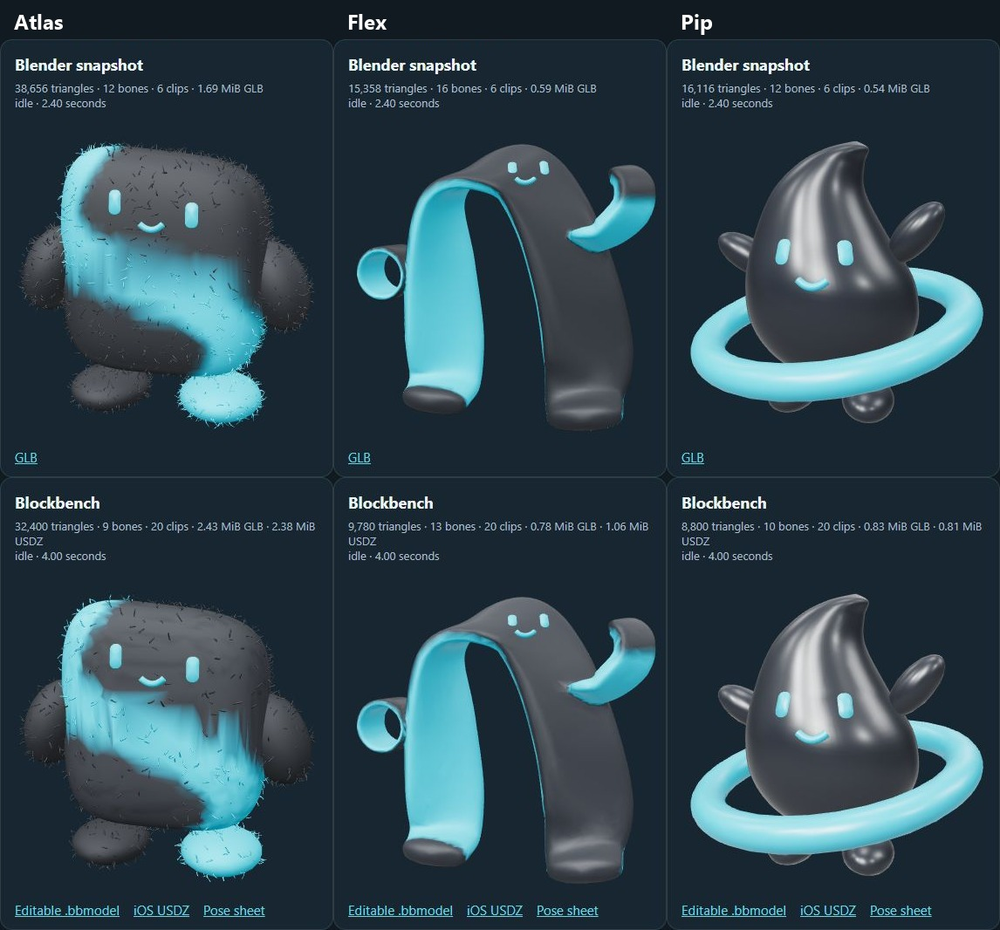

# Gym&I companions — Blockbench comparison

This delivery uses the app's selected V5 companions. It does not change the iOS app or the other chat's Blender files. Blockbench and its MCP were already installed; no second installation was needed.

Open the [interactive comparison](http://127.0.0.1:8766/) while the local preview server is running. It uses a frozen Blender export, the same studio lights and camera framing, and synchronized animation phase. Related clip names are shown explicitly. Blender currently has six clips per character; Blockbench has twenty. This is a comparison of these exports, not a benchmark of either editor.

| Companion | Editable source | iOS asset | Quick motion preview |
|---|---|---|---|
| Atlas | [atlas.bbmodel](atlas/atlas.bbmodel) | [atlas.usdz](atlas/atlas.usdz) | [Celebrate GIF](atlas/celebrate.gif) |
| Flex | [flex.bbmodel](flex/flex.bbmodel) | [flex.usdz](flex/flex.usdz) | [Stretch GIF](flex/stretch.gif) |
| Pip | [pip.bbmodel](pip/pip.bbmodel) | [pip.usdz](pip/pip.usdz) | [Float GIF](pip/float.gif) |

| Companion | Motion character | Triangles | Bones | GLB | iOS USDZ |
|---|---|---:|---:|---:|---:|
| Atlas / get stronger | Grounded, measured weight shifts and gestures; reduced fuzzy surface | 32,400 | 9 | 2.43 MiB | 2.38 MiB |
| Flex / build muscle | Elastic bends through the connected rubber ribbon | 9,780 | 13 | 0.78 MiB | 1.06 MiB |
| Pip / feel fitter | Buoyant float, glossy droplet, orbit motion | 8,800 | 10 | 0.83 MiB | 0.81 MiB |

**All three USDZ assets total 4.26 MiB.** Ship only the selected `.usdz` assets and their clip metadata. Editable `.bbmodel` files, GLBs, GIFs, review PNGs, Python scripts and the Blender comparison copies are development artifacts. Each exported companion has one mesh, one skin, one material and a 256×33 color texture. Geometry is shared by every clip; there are no image sequences or per-clip model copies in the runtime package.

[Download the iOS asset pack](gymni-companions-ios.zip). It contains only the three USDZ files, compact clip metadata and import notes. Unzip it before adding the assets to the iOS target; the full development folder is not intended for the app bundle.

Atlas preserves the source's fuzzy silhouette with fewer curls. Its color band and surface are coarser than the Blender snapshot. Flex's reduced mesh also loses some surface smoothness. Review those differences in the comparison before selecting an asset.

## Animation contexts

Each character contains: `idle`, `float`, `greeting`, `ready`, `listening`, `thinking`, `coaching`, `rep_good`, `form_correct`, `encourage`, `countdown`, `set_complete`, `celebrate`, `rest`, `breathe`, `stretch`, `pause`, `reconnect`, `workout_complete`, `goodbye`.

Names and durations are in each `manifest.json`. Loops return to their initial pose; one-shot gestures also settle to neutral. Related contexts intentionally reuse gesture patterns. Atlas stays comparatively steady, Flex bends its ribbon, and Pip adds lift and orbit movement. These support the hands-free coaching flow; backend events remain authoritative for reps, completion and connection status. Essential instructions must still appear as text or audio.

The `float`, `coaching`, `celebrate` and `stretch` GIFs provide quick motion previews. `all-animations.jpg` shows a representative pose for all twenty contexts.

## iOS handoff

Use `atlas/atlas.usdz`, `flex/flex.usdz`, or `pip/pip.usdz`. GLB is for the web comparison and general interchange; the existing RealityKit app should use USDZ.

Each USDZ contains a single skeletal animation bank at 24 samples per second. Select the context using `usd_clip_ranges` in its manifest; `start` and `end` are seconds within the bank. Trim the imported animation to that interval and repeat only clips marked `loop`. [Apple's AnimationView](https://developer.apple.com/documentation/realitykit/animationview) supports animation trimming. Clip selection has not been compiled or tested against the app's RealityKit loader on this Windows machine; importing and playing the whole bank would cycle through every context.

Before integration, stop existing procedural Pip body/orbit animation while a skeletal clip plays, fit the model to the companion viewport, obey Reduce Motion, and pause rendering when the companion is offscreen. Keep the iOS state and backend contracts unchanged. No new app dependency is required by these files.

## Reproduce and validate

Tooling uses the repository `.venv`: numpy, scipy, Pillow, fast-simplification and usd-core. The latter two were installed only as development tools; they are not app dependencies.

1. Run `.venv\Scripts\python.exe blockbench-companions\prepare_companions.py` from the repository root. This rebuilds editable projects from read-only source GLBs.
2. Create a 640×640 Blockbench MCP offscreen view named `companion_review`. For each character, evaluate the function in `export_in_blockbench.js` through the Blockbench MCP. This loads the editable project, evaluates its real animated mesh, renders previews, and invokes Blockbench's native glTF exporter.
3. Run `.venv\Scripts\python.exe blockbench-companions\package_mobile.py` to weld duplicate export vertices, reduce redundant animation keys, and create the USDZ banks. The packager restores the exact authored palette because the native glTF exporter can embed an empty PBR canvas.
4. Run `.venv\Scripts\python.exe blockbench-companions\validate_exports.py` for geometry bounds, normalized weights, clip names/durations/seams, animation movement, embedded texture identity, USDZ dependency integrity, skeletal sampling and nonblank moving previews. Results are in `validation.json` and each character's `blockbench-validation.json`.
5. Serve only this output directory: `.venv\Scripts\python.exe -m http.server 8766 --bind 127.0.0.1 --directory blockbench-companions`. The comparison loads pinned Three.js 0.180.0 from jsDelivr; internet access is needed for that preview library. The model files stay local.

Not yet checked: physical iPhone frame rate, thermal/battery impact, RealityKit material appearance, runtime clip trimming/blending and Reduce Motion behavior. File size and triangle reductions do not prove mobile performance.
