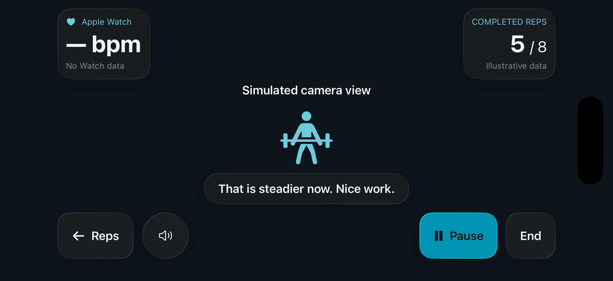

# Full-screen workout camera

Implemented in the native SwiftUI iPhone app. From an active workout, select **Camera** to rotate into landscape and show the video edge to edge. Selecting **Reps** restores portrait; pause and recap also use portrait. Both landscape directions are supported.

## Layout and interactions

- Upper left: Apple Watch heart rate, source label, and freshness. Missing readings show **— bpm / No Watch data**; old samples show **Stale · Waiting for sample**.
- Upper right: completed/target reps. Phone mode shows **— / Awaiting model** until the model integration is ready. Demo counts are explicitly illustrative.
- Lower center: one short coaching caption. In phone mode, a ready camera says **Camera live. Rep and form analysis pending.** Camera permission/loading errors use their actual status message.
- Lower left: **Reps**, coach mute/unmute, and a camera flip button for phone capture.
- Lower right: prominent teal **Pause** and separately labeled **End**.
- Video fills the available display and may crop at the edges. Controls respect safe areas and leave the central body-tracking area clear. A subtle top/bottom scrim supports text contrast against changing video.

Accessibility text sizes put metrics and captions into a scrollable area above persistent controls. Controls adapt into two rows when necessary; labels retain the user's text size. Reduce Transparency and Increased Contrast use solid panels.

## Visual specification

System typography: bold large-title metric values, readable body captions, monospaced numeric values. Minimum control hit areas remain at least 44 points.

| Use | Color |
| --- | --- |
| Camera fallback / glass tint | Blue charcoal `#0E1418` |
| Opaque accessibility panels | Deep slate `#1B272D` |
| Main text | Soft white `#F2F6F5` |
| Primary action | Teal `#0097B2` |
| Secondary accent text | Light teal `#6ECADB` |

Metric panels and the coaching caption use native Liquid Glass on iOS 26. Existing native glass button styles are retained. iOS 17–25 use system material backgrounds, preserving the iOS 17 deployment target. See [Apple's Liquid Glass documentation](https://developer.apple.com/documentation/swiftui/applying-liquid-glass-to-custom-views).

## Preview and validation

This is a direct simulator capture, rotated into display orientation. It shows **Demo** mode: no live camera or health measurements were captured, and the rep count/coaching are simulated. Real phone mode keeps the existing live camera capture path and does not generate fake reps. The submitted reference image informs the layout; it is not substituted for live footage.

Validated with an iPhone 17 Pro simulator on iOS 26.4:

- Camera switch, corner metric placement, readable coaching, and reachable pause/end controls.
- Both landscape orientations, return to portrait, pause, end, and recap navigation.
- Largest accessibility text size, persistent controls, and separated metric bounds.
- Simulator phone-camera mode does not fabricate live video or rep counts.

Three targeted UI tests passed with zero failures. Physical iPhone camera/Watch behavior still needs device verification; Chase's iPhone was offline during this UI work. No exercise model or Watch installation changes are part of this redesign.

## Design skills

Used UI/UX Designer and Web Design Engineer guidance for visual hierarchy, spacing, accessibility, and review, adapted to native SwiftUI. SwiftUI Pro and Code Tips guide the implementation. [Impeccable](https://github.com/pbakaus/impeccable) 4.5.2 was installed globally for Codex and its native/iOS guidance was applied. The npm install returned an invalid archive, so installation used the official repository's `.agents/skills/impeccable` directory through Codex's skill installer. Global skill listing and the engine probe verified the installation; automatic hooks were not enabled.
