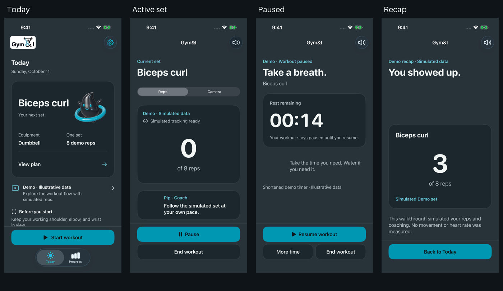

# Gym&I native product redesign

## Implemented direction

Focused training with a human coach beside you. The selected exercise leads Today; the completed rep count leads an active measured set; rest makes the paused state explicit; recap labels the source of the recorded data. Pip supports readiness, coaching, rest, and celebration using the supplied RealityKit model and its existing static fallback.

`ios/GymAndAI/Design/GymTheme.swift` remains the color source of truth. Background #283239, surfaces #1B272D, text #F2F6F5, secondary text #B8C5CB, action #0097B2, accent text #6ECADB, and charcoal #0E1418 are unchanged. There are no new image assets, charts, activity rings, or invented metrics.

## Shared system

- SF system typography: rounded large titles, title 2 section headings, body copy, and subheadline supporting labels. Rep and rest numbers use scaled, tabular system numerals without minimum-scale fitting.
- Spacing tokens: 4, 8, 12, 16, 20, 24, and 32 points. Pages use 24-point insets and a 600-point content-width limit.
- Opaque content surfaces use a 24-point radius and one quiet border. Controls use a 16-point radius and at least 52-point height. Toolbar targets are explicitly at least 44 points.
- `GymPage`, `GymSurface`, `GymActionDock`, `GymFormStyle`, and `WorkoutHeaderView` share layout and styling across the flow. Primary buttons use solid teal with charcoal text; secondary controls use slate surfaces.
- Native navigation and permission sheets remain native. Content and camera overlays stay opaque, including with Reduce Transparency. The existing Reduce Motion/static Pip behavior is retained. Display and session-state changes use native sensory feedback.
- The launch treatment is a brief, dismissible official-logo presentation with a simple fade, replacing the previous gradient, bounce, and sliding overlay.

## Screens and truthful states

**Today:** exercise-first hierarchy, smaller Pip companion, selected equipment/target, setup source, exercise-specific preparation guidance, native Settings location, and a pinned Start action. The former generic encouragement and training-category copy were removed.

**Plan:** one exercise and one set, exercise and mode selection, equipment, source-specific target explanation, Live webcam/Recorded selection for Laptop, and exact positioning guidance. Laptop requests eight reps only when starting a ready session; an existing session retains the backend’s exercise and target.

**Positioning:** selected exercise, explicit mode, exact guidance, actual iPhone camera availability, optional Watch setup, and pinned Start set/End controls. Demo states that no camera runs and retains its existing automatic three-second transition. Laptop attaches directly to backend state rather than adding a new local positioning stage.

**Active workout:** large rep count or an explicit unmeasured camera explanation, source/tracking text, one current coach message, Watch reading age/unavailable state, Reps/Camera display switch, mute, and pinned Pause/End. Old feedback must belong to the current set and active issue to be displayed. Changing display still only changes `WorkoutDisplay`.

**Camera:** landscape, aspect-fitting video, opaque metrics and coach overlays, and 52-point controls. The previous fill crop was corrected for both external MJPEG and iPhone preview surfaces. Recorded footage is explicitly named. Accessibility sizes have scrollable details and concise metric labels; essential controls remain outside the details scroll view. Missing video does not affect backend workout events.

**Rest:** quiet paused heading, prominent timer, explicit “stays paused until you resume” copy, smaller resting Pip, primary Resume, and visible More time/End controls. At accessibility text sizes, the countdown uses total seconds to avoid compressing a five-character clock. Expiry does not resume the workout.

**Recap:** selected exercise, actual rep count or explicit unmeasured session, restrained Pip celebration, source explanation, and pinned Back to Today.

**Progress:** intentional empty state or the last session retained in memory. Demo, recorded Laptop, and unmeasured iPhone data have distinct labels. `WorkoutSession` now retains the completed mode, exercise, and input source alongside the existing result, so later setup changes cannot relabel a recap. Starting a new workout still clears the prior result; no history persistence was added.

**Settings:** consistent native Form surfaces, workout mode first, Health/Watch access, laptop fields, laptop preview, and spoken coaching. Existing fields and permission/action semantics remain. Pending workout actions show “Confirming action…”. The visible app and permission-copy spelling is Gym&I; bundle identifiers and targets stay unchanged.

## Decisions grounded in the current code

- iPhone video does not yet measure reps or form. It never receives a fabricated counter or score.
- The Watch companion and telemetry bridge are already implemented, despite historical README text calling them future work. Permission completion still does not prove read access; fresh telemetry is required for BPM.
- The backend is authoritative for Laptop reps, state, tracking, and acknowledgments. No counting logic moved into views.
- No load metric is retained in the current UI snapshot/store, so the redesign does not invent or infer a weight.
- Demo events are simulated. Recorded footage labels do not claim live camera measurement or establish inference provenance beyond the existing event contract.
- No duration, calories, score, streak, history chart, or personal record was added.
- iOS 17 and Swift 6 deployment settings are preserved; implementation is built with the installed Xcode 26.4 SDK.

## Validation

- `swift test` in `ios/GymAndAIKit`: **17 tests passed**. This includes source retention after setup changes, unmeasured phone sessions, display switching, explicit resume after rest expiry, event decoding/deduplication, bounded preview parsing, and stale/invalid Watch data.
- Xcode 26.4 simulator build: **passed**, retaining iOS 17 deployment settings.
- iPhone 17 Pro / iOS 26.4: **all 10 UI tests passed**, including the real local FastAPI REST/WebSocket command flow, fixture rep/heart-rate events, stale BPM removal, recorded-source Progress, Health permission completion, Pip lifecycle/fallback/Reduce Motion, orientation switching, and large text.
- iPhone 16 / iOS 18.4: **3 compatibility UI tests passed** for the standard workout journey, large-text controls, and unavailable iPhone camera/unmeasured recap.
- The final targeted accessibility UI test also passed. It targets Rest’s scroll view, keeps the test gesture above the fixed dock, and confirms the countdown is visible above Resume. The captured timer was also visually checked.
- `git diff --check`: clean.

The backend test uses explicitly recorded fixture observations and injected heart-rate samples. Its 112 BPM screenshot validates event display and freshness handling; it is not a real Watch reading. Demo captures show simulated reps. No hardware video is substituted into an unavailable preview.

Physical camera capture, real Watch samples, audible music ducking, and device haptics require hardware and are not established by simulator tests.

### Actual simulator captures

[Today](native/redesign/today.png) · [Plan](native/redesign/plan-review.png) · [Settings](native/redesign/workout-settings.png) · [Reps](native/redesign/reps.png) · [Rest](native/redesign/rest.png) · [Recap](native/redesign/session-recap.png) · [Empty Progress](native/redesign/progress-empty-state.png) · [Recorded Laptop Progress](native/redesign/recorded-laptop-progress.png) · [Unavailable iPhone camera](native/redesign/iphone-positioning-unavailable.png) · [Unmeasured recap](native/redesign/unmeasured-recap.png)

Camera captures were obtained directly with `simctl` and rotated to display orientation, because the XCTest exports can misrepresent forced landscape orientation. [Laptop camera with injected fixture heart rate](native/redesign/laptop-camera-with-fixture-heart-rate.png) and [large text camera](native/redesign/large-text-camera.png) show the actual native layout. Portrait captures, including [large text rest with the countdown visible](native/redesign/large-text-rest.png), are exported XCTest attachments.

Design guidance: SwiftUI Pro, and UI/UX Designer by [Madina Gbotoe](https://madinagbotoe.com/), adapted to the requested native SF typography and existing brand palette.
