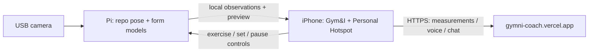

# Standalone Gym&I tripod

The Pi owns the USB camera, MediaPipe pose extraction, and this repository's trained form models. The iPhone owns workouts, exercises, sets, committed reps, rest, captions, and audio. The phone sends completed measurements to the preset Vercel API. Video stays on the hotspot.



## Everyday use

1. Enable Personal Hotspot on the paired iPhone.
2. Power the tripod from its own supply and position the USB camera.
3. Open Gym&I and start a workout. Allow Local Network access when iOS asks. Tap the camera button to view the tripod's live picture; Show Reps returns to the workout.
4. The Pi joins the saved hotspot, discovers the phone, and follows its current exercise/set. Preview connects automatically.

No IP address or website entry is required. Wi-Fi credentials are saved once during pairing. Keep Gym&I open during an active workout: iOS can suspend the local server in the background, and the app pauses workouts when backgrounded. The phone camera remains free.

## Installed prototype

The attached Pi has current ML source under `/home/tamousta/gymni/ml/src` and the selected repository models under `ml/models`. `gymni-tripod.service` starts `pi/start.py` at boot and restarts after camera/process failures. The saved `gymni-hotspot` NetworkManager profile reconnects automatically and prefers the hotspot over maintenance Ethernet.

The saved hotspot profile probes the known SSID when it is hidden, retries autoconnection indefinitely, and disables Wi-Fi power saving. Apply these settings during pairing with `sudo nmcli connection modify gymni-hotspot 802-11-wireless.hidden yes connection.autoconnect-retries 0 802-11-wireless.powersave 2`. If preview cannot connect, check iPhone Settings → Privacy & Security → Local Network → Gym&I. Receiving observations alone does not prove the phone has permission to open a camera connection.

The interpreter is the verified Python 3.12 / MediaPipe 0.10.18 / OpenCV 4.11 / Torch CPU environment. Its location is under the older software directory, but `start.py` imports **this checkout's** `fitness_ml`, never Taher's application. The older environment/applications are preserved. Discovery dependencies are installed separately under ignored `pi/vendor`.

Install on another Pi after placing the same verified runtime and repository model bundle:

```sh
bash pi/install.sh /absolute/path/to/verified/python3.12
```

An optional second argument supplies an offline wheel directory. Do not replace this Pi 4 runtime with the Mac ML package's default MediaPipe/OpenCV pins; Pi CPU compatibility was verified separately.

Maintenance commands on the Pi:

```sh
systemctl status gymni-tripod
journalctl -u gymni-tripod -n 50 --no-pager
sudo systemctl restart gymni-tripod
```

Capture is 640×480; inference resizes to 480 pixels wide and is capped at 8 FPS. The phone receives clean camera frames without the desktop debug panel or skeleton. Its full-screen preview crops to fill the display; analysis still uses the whole camera frame. Actual speed and accuracy depend on framing, visibility, movement, and model quality. A real exercise trial remains required.

## Connection and data behavior

The phone publishes `_gymni._tcp` via Bonjour. The Pi also derives the Wi-Fi gateway from DHCP, so hotspot multicast failures do not require manual addressing. Only a `gymni-phone` v1 configuration is accepted. The hotspot gateway is preferred when maintenance Ethernet is also connected.

Controls refresh every second. A lost control lease stops analysis and discards partial reps. Workout, exercise, set, state, and revision changes reset partial movement. Queued observations carry the workout ID/revision; the phone rejects stale uploads and applies its existing tracking/exercise/confidence checks. A disconnect can lose an uncommitted rep; missing counts are never reconstructed.

The phone currently exposes curl, squat, and deadlift. The installed repository bundle includes all eight form classifiers and the exercise recognizer. Tripod mode follows the phone's exercise selection rather than running automatic exercise recognition.

Completed journals go to `POST /api/workouts/summary`. Vercel validates committed measurements and returns deterministic rep/duration/issue summaries with zero workout LLM tokens. Journals and summaries remain on iPhone; this endpoint does not store cloud workout history. Failed requests remain pending on disk and retry when the app reconnects/starts another workout. Gemini, Backboard profile memory, and ElevenLabs remain hosted, with provider keys only on Vercel.
